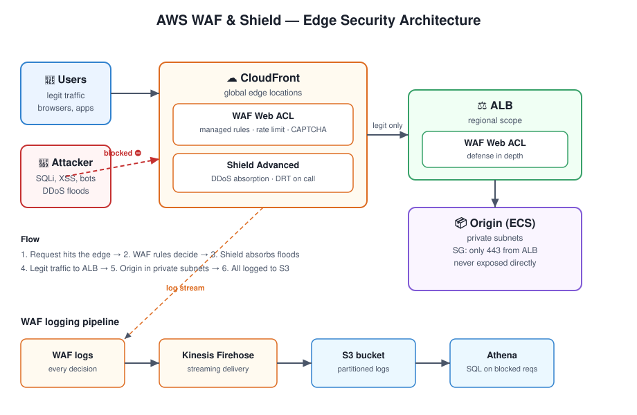

# AWS WAF & Shield Guide

> Your app has a firewall in the VPC. Cute. The internet doesn't knock on your
> VPC door — it slams into your **edge**. **AWS WAF** inspects every HTTP request
> at the edge and blocks the bad ones; **AWS Shield** absorbs the DDoS floods
> before they ever reach you.

## TL;DR

**AWS WAF** is a web application firewall: you write (or borrow) rules that match
SQL injection, XSS, bad bots, geo locations, or request-rate spikes — and each
request is **allowed, blocked, counted, or challenged (CAPTCHA)** at the edge,
before it touches your origin. **AWS Shield Standard** protects every AWS resource
from common network/transport-layer DDoS attacks **for free**; **Shield Advanced**
adds bigger guarantees, 24/7 DRT support, and cost protection for the brave (or
the heavily attacked).

The combo that matters: **CloudFront → WAF → ALB/API Gateway → your app**, with
Shield riding along for the flood control.

## Architecture

Traffic flow:

1. **Attacker & legit users** hit your CloudFront distribution first — the edge.
2. **WAF Web ACL** evaluates every request against your rules (managed rules,
   rate-based rules, custom rules) — block at the edge, not at the origin.
3. **Shield Advanced** (optional paid tier) stands behind CloudFront/Route 53/ALB
   for large-scale DDoS absorption with the DDoS Response Team on call.
4. Legit traffic reaches the **ALB**, which can carry its own regional WAF Web ACL
   for defense in depth.
5. **Origin** (ECS/EC2) lives in private subnets — nothing reaches it except
   through CloudFront + ALB.
6. **WAF logs** stream to S3 via Kinesis Firehose for Athena analysis: every
   blocked request is a lesson.

## Layered Defense: Who Does What

| Layer | Service | Stops | Example |
|---|---|---|---|
| Edge (L7) | **AWS WAF** | SQLi, XSS, bots, scrapers, geo abuse, rate floods | Block `UNION SELECT` in a query string |
| Edge (L3/L4) | **Shield Standard** | SYN floods, UDP reflection, common DDoS | Free, always on |
| Edge (L3/L4+) | **Shield Advanced** | Large/sophisticated DDoS | 24/7 DRT, cost protection |
| VPC boundary | Security Groups / NACLs | Port-level access | Only 443 from the ALB |
| Origin | App code + secrets | Logic bugs, leaked creds | Input validation, Secrets Manager |

> **Rule of thumb:** WAF answers *"is this request malicious?"*; Shield answers
> *"can we survive the flood?"*; Security Groups answer *"who may knock at all?"*

## WAF Rule Evaluation, Demystified

A **Web ACL** holds rules, each with an **action** and a **priority** (lower = first):

- **Allow / Block / Count** — the classics. `Count` is your dry-run mode:
  it logs matches without blocking. Use it before turning any rule to `Block`.
- **CAPTCHA / Challenge** — silent JavaScript/proof-of-work checks that stop bots
  without punishing humans.
- **Rule groups** — AWS Managed Rules (`AWSManagedRulesCommonRuleSet`,
  `AWSManagedRulesSQLiRuleSet`, `AWSManagedRulesKnownBadInputsRuleSet`, …),
  plus your own custom rules.
- **Rate-based rules** — block IPs exceeding N requests per 5 minutes. Your
  cheapest anti-scraper.

### Deploy new rules like a grown-up

1. Add the rule with action **Count**.
2. Watch the logs for a day — false positives show up here, not in an incident.
3. Flip to **Block** (or CAPTCHA for the cautious).
4. Never deploy a Block rule on Friday afternoon. You know why.

## Cost Notes (learned the hard way)

| Item | Price (us-east-1, approx) |
|---|---|
| WAF Web ACL | $5/month each |
| WAF rules | $1/month per rule |
| WAF requests | $0.60–$1.00 per million |
| Shield Standard | **Free** (always on) |
| Shield Advanced | **$3,000/month** — only if you're a real target |

WAF at the edge is cheap insurance. Shield Advanced is a business decision,
not a technical one — enable it when downtime costs more than $3k/month.

## Quick Start

See [`waf.tf`](waf.tf) — a complete Terraform example: a CloudFront-scoped Web ACL
with AWS Managed Rules (common, SQLi, known-bad-inputs), a rate-based rule,
Bot Control, and logging to S3. Customize the rate limit and geo blocks,
`terraform apply`, attach it to your distribution.

## Quiz

Think you got it? [Take the 5-question quiz](quiz.md) — WAF actions, Shield
tiers, rule evaluation order, and the classic "why is my legit traffic blocked?"
